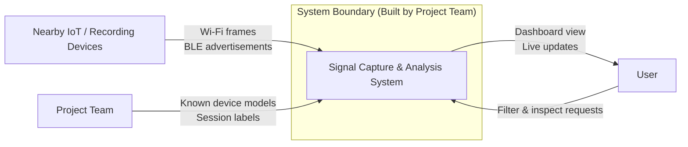

# Design — System context

> Epic: #47, #50, #56 · Stories: #16, #45, #51, #57, #58
> Owner: Jasmine Cerasuolo (@jcerasuolo5) · Sprint: 3 · Status: draft · Task: #97, #102
> Specification: none yet
> Related: high-level architecture diagram (#84), data flow diagram (#77), ER diagram (#82)

This document answers one question: **where does our system stop, and who or
what is outside it?** Figure 1 draws the system as a single box inside the
boundary of what the project team builds. Everything outside that boundary is
something the system receives from or delivers to, and every arrow is
labeled with what crosses the boundary.

*Figure 1 — System context: what the Signal Capture & Analysis System
exchanges with the world outside it. Every arrow is a decided data flow.
Hosting is not shown because no host has been chosen yet (see §4).*

Exported image: [`diagrams/system-context.png`](diagrams/system-context.png).
The Mermaid code above is the editable source.

## 1. What crosses the boundary

| Outside entity | Sends to the system | Receives from the system | Status |
|---|---|---|---|
| Nearby IoT / recording devices | Wi-Fi frames, BLE advertisements | nothing | decided |
| Project team | known device models, session labels | — | decided |
| User | filter and inspect requests | dashboard view, live updates | decided |

**Nearby IoT / recording devices** are outside the boundary because the team
does not build or control them. The system only listens to the signals they
already broadcast; it never transmits to them. That is consistent with the
sponsors' instruction to avoid invasive methods such as retrieving data from
Flock cameras (#70).

**The project team** supplies the reference data the system needs to
identify devices: the catalog of known device models and the labels for each
test session (#51).

**The user** is the person checking what is recording around them. They
interact with the system only through the dashboard (#57, #58).

## 2. How this relates to the other diagrams

This diagram treats the whole system as one box. The high-level architecture
diagram (#84) opens that box and shows the ESP32 capture nodes, backend API,
database, and dashboard inside it. The data flow diagram (#77) shows how data
moves and is transformed between those pieces; its Level 0 view covers the
same external entities. This diagram adds the system boundary itself, making
explicit what the team builds versus what it depends on.

## 3. Key decisions

| Decision | Options considered | Chosen | Why |
|---|---|---|---|
| Sponsors on the diagram | include them · leave them off | left off | they review the team's work but exchange no data with the system |
| Hosting on the diagram | show a proposed host · leave it off | left off | no host is chosen; the mentors asked for a free service, an open-source tool, or something the team builds itself, so AWS Lightsail (#86) was dropped (#102). A box is added once the team decides |
| How signals are captured | passive listening to broadcast signals · access to the network's router | passive listening, as shown in the architecture diagram (#84) | it works without control of the local network; proposal §1.1 still assumes router access "at least for testing," which would add the test router as an outside entity if the team adopts it |

## 4. Not shown or not decided yet

- **Hosting:** not decided. AWS Lightsail was dropped after mentor feedback
  (#102); the team is considering a free or self-hosted option. If the team
  hosts the server itself, it stays inside the boundary; if it uses an outside
  service, that service is added as an outside entity.
- **Dashboard framework:** the architecture diagram lists it as TBD, while the
  ER and data flow diagrams name Angular. This diagram does not depend on the choice.
- **Sponsors:** Tracy and Cara give the team feedback but exchange no data
  with the system, so they are not on the diagram.
