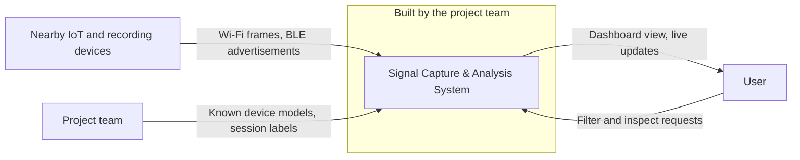
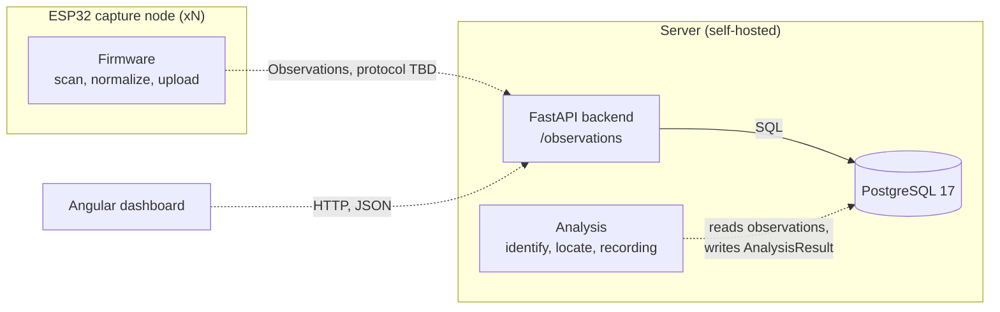
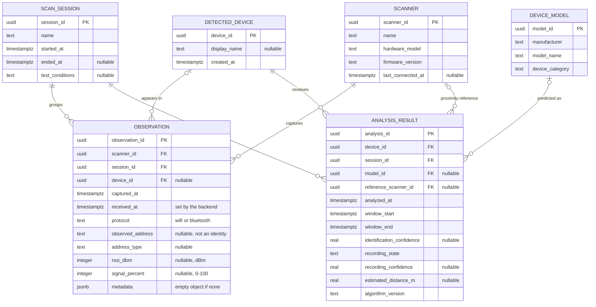
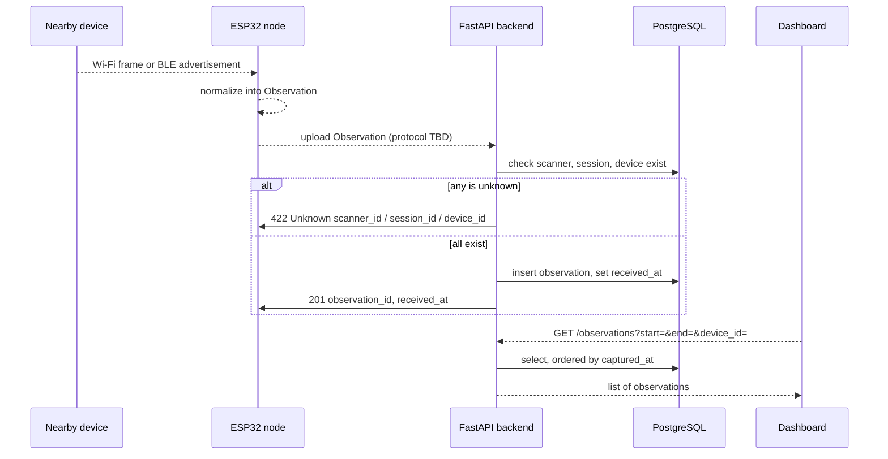

# Design — Signal capture and analysis system

> Epic: #47, #50, #56 · Stories: #16, #45, #46, #48, #49, #51, #52, #53, #54, #55, #57, #58, #59, #60, #61
> Owner: Eli Thomas (@eliThomass) · Sprint: 4 · Status: draft · Task: #119
> Specifications: [`signal-capture-and-storage.md`](../specs/signal-capture-and-storage.md) (#47) ·
> [`device-identification.md`](../specs/device-identification.md) (#50) ·
> [`dashboard.md`](../specs/dashboard.md) (#56)
> Related: [`system-context.md`](system-context.md) (#97) ·
> [`architecture.md`](architecture.md) (#84) · [`data-flow.md`](data-flow.md) (#77) ·
> ER diagram (#82)

This document covers the whole system in the six parts the course asks for.
The three diagram documents linked above each go deeper into one part; this
document ties them together and records what exists in `prototype/` today.
Solid lines in the figures exist in the prototype; dashed lines are planned.

## 1. System context

The system is one box built by the project team. Nearby devices send it
signals they already broadcast, the team gives it known device models and
session labels, and the user sees the results on the dashboard. The system
never transmits to the devices it observes. Full description:
[`system-context.md`](system-context.md).

*Figure 1 — System context. Sponsors and hosting are left off on purpose;
see `system-context.md` §3.*

## 2. Components and their responsibilities

*Figure 2 — Components. Only the backend-to-database connection runs today;
the firmware does not capture or upload yet, analysis is not built, and the
dashboard does not call the backend yet.*

| Component | Responsibility | Interface | Where | Status |
|---|---|---|---|---|
| ESP32 firmware | Scan Wi-Fi and Bluetooth, turn each capture into an Observation, upload it | upload protocol TBD | `prototype/esp32/` (PlatformIO, Arduino framework, `esp32dev`) | skeleton builds (#92); capture waits on boards (#16, #45) |
| Backend API | Validate, store, and return observations | `POST /observations`, `GET /observations?start=&end=&device_id=`, `GET /health/db` | `prototype/backend/main.py`, `schemas.py` | built (#112, #113) |
| Database | Hold observations, scanners, sessions, devices, models, results | SQLAlchemy models; tables created on first connect | `prototype/database/` (Docker Compose), `prototype/backend/models.py` | 4 of 6 tables built (#93, #108) |
| Analysis | Identify devices, estimate proximity, investigate recording state | writes `AnalysisResult` | not built | CPSC 491 (#53, #54, #55) |
| Dashboard | Show nearby devices, confidence, proximity, last seen | reads the backend over HTTP | `prototype/dashboard/` (Angular) | starter page only (#94) |

## 3. Data model

Six PostgreSQL entities, from the ER diagram (#82). An Observation is one
captured signal from one Scanner, grouped into a ScanSession and matched to a
DetectedDevice when possible. AnalysisResult holds the backend's predictions
for a device over a time window.

*Figure 3 — Entity-relationship model, redrawn from the ER diagram (#82,
`NodeAnalysisERdiagram.png`). `SCANNER`, `SCAN_SESSION`, `DETECTED_DEVICE`,
and `OBSERVATION` exist in `models.py`; `DEVICE_MODEL` and `ANALYSIS_RESULT`
do not yet.*

Rules the model enforces, and the requirement each one serves:

- `scanner_id`, `session_id`, `captured_at`, and `protocol` are required;
  everything else may be unavailable (capture spec FR-7, NFR-4).
- `rssi_dbm` and `signal_percent` are separate columns, and neither is
  computed from the other (capture spec FR-10, NFR-3).
- `observed_address` is evidence, not identity; identity lives in
  `DETECTED_DEVICE` (capture spec NFR-2).
- `algorithm_version` lets results from different fingerprint versions be
  told apart (identification spec NFR-5).

## 4. Data flow

Every capture follows the same path. The ESP32 scans (processes 1.0 and
2.0), normalizes the raw record into an Observation (3.0), and uploads it
over Wi-Fi. The backend validates and stores it (4.0). Analysis reads stored
observations and writes results (5.0–7.0), and the dashboard reads both
(8.0). Level 0 and Level 1 diagrams and the process and store tables are in
[`data-flow.md`](data-flow.md).

*Figure 4 — One observation from capture to display. Solid arrows are built
and tested (`test_observations.py`); dashed arrows wait on the boards
(#16, #45) and the dashboard (#57).*

## 5. Key decisions

| Decision | Options considered | Chosen | Why | Source |
|---|---|---|---|---|
| Capture hardware | laptop Wi-Fi adapter · Kismet as the capture layer · ESP32 nodes | ESP32 nodes | covers Wi-Fi and Bluetooth, stays in the room, and more nodes can be added; a laptop adapter covers only Wi-Fi and ties capture to one computer; Kismet is built for network admins | proposal §3 |
| Capture method | passive listening · access to the network's router | passive listening | works without control of the local network and avoids invasive methods | `system-context.md` §3, #70 |
| Node to server transport | USB serial to a computer · Wi-Fi upload | Wi-Fi upload | keeps the node untethered and lets several nodes report to one backend | proposal §3, `data-flow.md` §5 |
| Where normalization happens | on the server · on the node | on the node | the backend and dashboard only ever receive one format | proposal §3 |
| Device identity | observed address as identity · address as evidence | address as evidence | devices randomize their addresses | proposal §3, ref. 5 |
| Identification approach | MAC manufacturer lookup · general-purpose classifier (Lumos) · fingerprints of a small selected set from our own labeled data | selected set | randomization defeats MAC lookup; a general classifier only knows devices like its training data; a narrow set gives a claim we can measure | proposal §3 |
| Proximity | GPS last-seen location (Kismet) · user walks the room (Lumos, SnoopDog) · signal strength | signal strength | already in every observation and needs nothing from the user | proposal §3 |
| Recording detection | correlate the user's movement with traffic (SnoopDog) · compare recording and idle captures | compare captures, as an investigation | passive; a negative result backed by captures is acceptable | proposal §3, #55 |
| Dashboard style | raw log or packet view (Kismet) · explained device list | explained device list | users are non-technical | proposal §1, §3 |
| Dashboard framework | Angular; other options not recorded | Angular | the sponsors know Angular and can support the team | #70 |
| Hosting | AWS Lightsail (~$168 for 8 months) · free or self-hosted server | self-hosted | the sponsors asked for a free option | #101, #102 |
| Training labels | separate labels entity · optional label fields on `ScanSession` | label fields on `ScanSession` | not recorded; see §6 | `data-flow.md` §5 |

## 6. What is not designed yet

- **Node-to-backend protocol.** How the firmware uploads observations
  (`architecture.md` §5).
- **Creating scanners and sessions.** `POST /observations` needs existing
  `Scanner` and `ScanSession` rows, and no endpoint creates them.
- **Matching observations to devices.** Process 4.0 matches an Observation
  to a `DetectedDevice`; today `device_id` is set only if the client sends
  it.
- **Several nodes.** How observations of one device from several nodes are
  combined (`architecture.md` §5).
- **Scan failures.** `data-flow.md` §5 says failures are not stored or
  shown, but #16 and #49 require them to be reported.
- **Session labels.** `ScanSession` has only `test_conditions`; the dataset
  needs the device model and recording state per session (`data-flow.md`
  §6).
- **Analysis.** `DEVICE_MODEL`, `ANALYSIS_RESULT`, and processes 5.0–7.0,
  including the window length and confidence threshold.
- **Dashboard updates.** Polling or push, the endpoints the dashboard needs,
  and the staleness cutoff.
- **Server.** The self-hosted machine and how teammates reach it.
- **Decisions without a recorded reason.** PostgreSQL and FastAPI were chosen
  at the 2026-10-20 team meeting (#79), and the training-label choice in §5
  came from the data flow diagram, but the reasons and the alternatives were
  not written down.

Each item is also an open question in the specification it belongs to.
