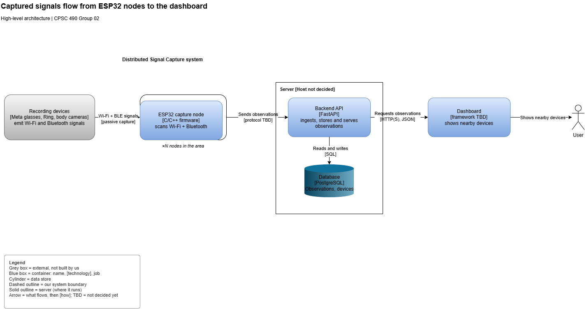
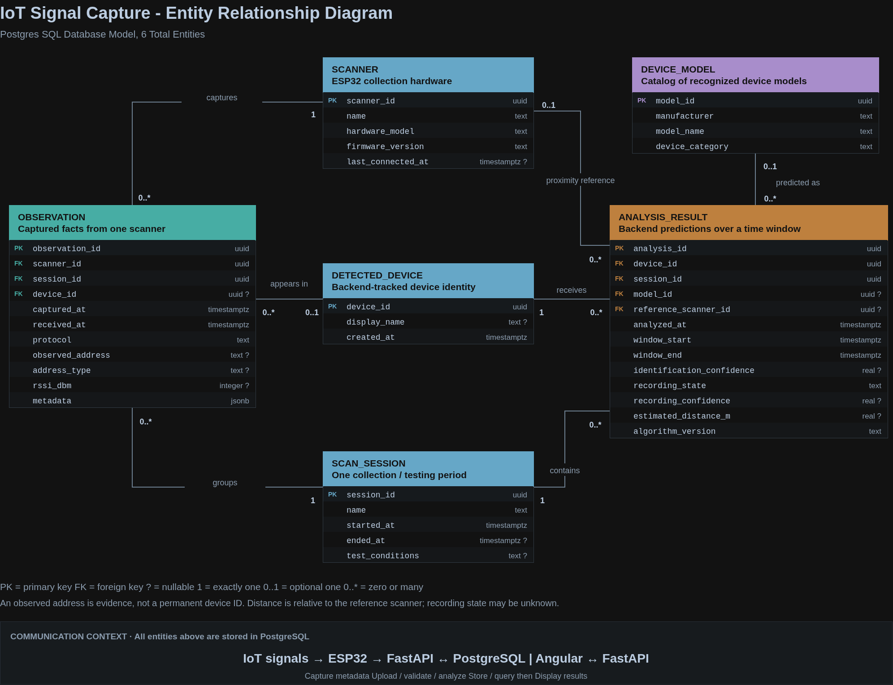
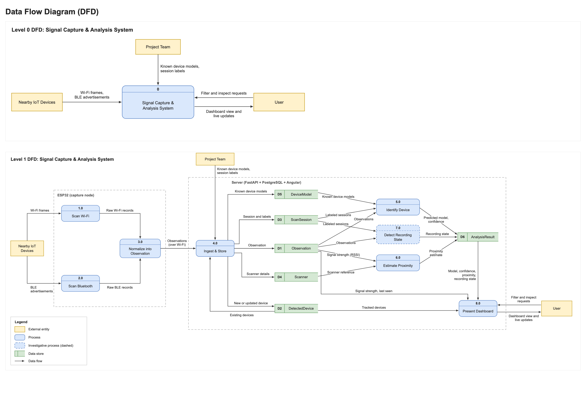
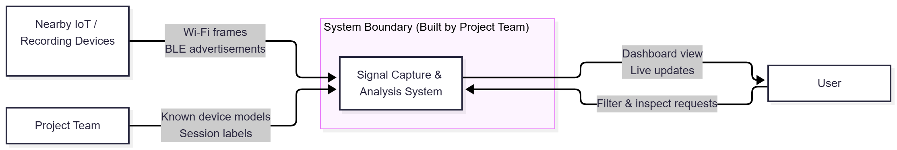

# Project Proposal — Distributed Signal Capture for Multi-Node Analysis

**Department of Computer Science**
**CPSC 490 Undergraduate Seminar in Computer Science — Proposal for Capstone Project**

**Group 02 — Linux Larpers** · Sponsor: RTX-4  
Authors: Thomas, Eli (eliThomass), Perry, Ryan (Perryboi8), Cerasuolo, Jasmine (jcerasuolo5), Huynh, Chris (chroyy), Soo, Jonathan (soo-nexus)  
Repository: https://github.com/eliThomass/CPSC490-G02-Linux-Larpers  
Date: 2026-10-11

> **This file is the proposal document, not a README.** Its section numbers,
> titles, and guidance are copied from the course Word template, so it
> converts cleanly for Canvas submission. Write continuous academic prose —
> no task lists, no emoji, no repo jargon.
>
> Each section below opens with the template's own guidance in a quote block.
> **Delete the quote blocks and every 〈bracket〉 before submitting.**
>
> **Getting this into the Word template for Canvas.** The template numbers
> its headings **automatically** (a multilevel list: top-level sections at
> level 1, *Related Work* and *Problem Statements* at level 2). The numbers
> typed below exist so the repo copy is readable and checkable — so when you
> move the text into Word, do not end up with both sets.
>
> The reliable route, and the one most teams should use: **open the course
> template and paste your prose section by section**, leaving Word's own
> numbering to do the numbering. Ten minutes, no surprises.
>
> If you prefer to convert, `pandoc` can do it (install with
> `winget install pandoc`):
>
>     pandoc proposal/proposal.md -o proposal.docx --reference-doc="CPSC 490 Project Proposal Template Fall 2026.docx"
>
> Then in Word: delete the typed `0.` / `1.` / `1.1` prefixes (Word re-adds
> them from the list), and set *Related Work* and *Problem Statements* to the
> template's level-2 heading so they number as 1.1 and 1.2. Check figure
> placement, then submit.
>
> Either way, keep this Markdown copy current — it is what peer review and CI
> can actually read. If your team writes in Word instead, commit the `.docx`
> here as well.

---

## 0. Abstract

The Internet of Things (IoT) connects physical devices to computing systems, allowing them to exchange data and communicate through networks. Recording devices and network-connected cameras are commonly found in everyday environments, and their presence keeps growing, from home security cameras to Flock cameras. Devices such as Ring cameras, Meta glasses, body cameras, and spy cameras can record people without them knowing, which makes it harder for people to know where their privacy may be affected. These devices emit signals that may be observed and may provide information about their activity and location. By observing and understanding these signals, individuals can better understand how everyday IoT devices communicate and become more aware of the devices operating around them.

The problem this project addresses is the difficulty of identifying and understanding nearby network-connected devices in real time. There are existing tools that can detect network devices already, but the information provided by these tools does not give the user a good understanding of what devices are present and where they are located. Our project, Distributed Signal Capture for Multi-Node Analysis, proposes a system that helps people understand where their privacy may be affected by showing them which recording and network-connected devices are around them and approximately where those devices are. In this project, each IoT device in range is treated as a node. As a user enters an area, the system captures the signals of every device within range and sends the signal metadata to a backend for analysis, such as device fingerprinting, which tells devices apart based on their observable traits. The capturing software is meant to run on an ESP32, which feeds information to a server database.

This system will be able to map device presence in real time and pick out a small set of known devices: Meta glasses, Ring cameras, body cameras, and spy cameras. Although there are already tools available such as Kismet that provide network monitoring, our project will also investigate whether a device's signal metadata can show if it is actively recording nearby. The info this project provides will be shown through a user-friendly dashboard that shows detected devices and their approximate location, so the processed information is easier for the user to understand. Building this is non-trivial because it combines wireless protocol fundamentals (Wi-Fi, Bluetooth), device fingerprinting, and multi-node data analysis in one system. This will allow users to be more aware of the network-connected devices operating around them.

By the end of this project, we will have a signal capturing architecture utilizing a server and an ESP32 that meets three goals. First, it will collect Wi-Fi and Bluetooth signal metadata from devices within range. Second, backend services will analyze that metadata to fingerprint and identify a selected set of recording devices, estimate their approximate locations, and investigate whether a device is actively recording. Third, a frontend dashboard will reveal detected devices and their approximate locations in real time, in a way that is easy to understand. This semester (Fall 2026) focuses on the proposal and planning phase of the project, including a working prototype. The full implementation will come next semester in CPSC 491. In the future, this project could evolve into a more complete signal analysis platform that can detect even more types of monitoring devices.

The rest of this proposal covers the background, related work, and problem statement (§1), our goals and objectives (§2), the proposed approaches (§3), the required environment, resources, and planned activities (§4), the expected outcomes and timeline (§5–§6), and our AI usage and references (§7–§8).

## 1. Introduction

  The Internet of Things (IoT) connects physical devices to computing systems through which they can exchange data. In this project, the devices of interest include network-connected cameras and wearable recording devices, such as Ring cameras, Meta glasses, and body cameras. Being able to understand the presence of such devices involves both signal capture and data analysis. This will include observing signals emitted by devices within range and interpreting those observations to be able to develop a useful picture of the surrounding environment. This project's main goal is **privacy awareness**, helping individuals map which devices are present and what their observable activity may reveal.

  Our project, *Distributed Signal Capture for Multi-Node Analysis*, aims to map device presence in real time by capturing signals from devices within range as a user enters an area. Our signal-capturing software is intended to operate on an ESP32. Backend services will run on a computer server to collect signal metadata from each node for analysis, including device fingerprinting to distinguish devices based on their observable traits. A frontend dashboard, also running on the server, will present detected devices and their approximate locations, giving users a spatial view of device presence.

  Our project combines distributed signal collection, metadata analysis, and real-time visualization within a single system. We also intend to investigate whether observable metadata can indicate if a device is actively recording. We intend to have an accessible, user-friendly dashboard that translates signal metadata into understandable information about nearby devices in real time.

  This problem matters because recording devices now capture people who never agreed to be recorded and often cannot tell that they are being recorded. Doorbell cameras record sidewalks and neighbors' doorsteps, smart glasses can record with only a small indicator light to signal it [1], and body cameras record everyone their wearer interacts with. The people most affected are bystanders rather than device owners. They include guests in short-term rentals, where hidden cameras have been reported [2], [3]; participants in meetings, classes, or interviews where a wearable device may be recording; and residents of shared spaces such as apartments and dormitories. For these people the harm is not only being recorded, but that footage may be stored, uploaded, or shared without their knowledge. At present they have no practical way to check what is recording around them, and the tools that do exist assume technical expertise most of them do not have.

  What makes our project different from others which are similar is that ours focuses on the bystander. Wireless monitoring tools such as Kismet [4] report and track the networks and devices in range, but they assume a technical user will inspect the data. Our system narrows the scope down to recording devices, allowing for more accurate fingerprinting and location tracking. This is combined with a user interface that someone non-technical can read and understand. Additionally, we will investigate whether the signal metadata can show that a device is actively recording, so users don't just know if a camera is nearby, but if it's live and capturing their actions.

### 1.1 Related Work

| Existing approach | What it does | Pros | Cons | Why ours differs |
|---|---|---|---|---|
| Kismet [4] | An open-source wireless monitoring tool & sniffer. It can capture packets for a multitude of wireless specifications including Wi-Fi, Bluetooth, BTLE, and more. Essentially it passively captures packets from different sources and logs info such as packets, devices, location, and other runtime data to a SQLite-based DB. It also includes MAC lookups for different manufacturers. Uses GPS to determine location through a running average of positions where the device was seen. | In-depth and trusted software which has been around for a long time. It has lots of features other than detection, such as alerting for intrusion detection. It includes remote capture programs which can run on small devices, which could be used to track rooms all the time, increasing security. | It is designed for security professionals and network admins, so the data it does log can be hard for a non-technical user to understand. Does not include recording detection or classify devices by type. | Our program will differ from Kismet by using a simplified approach. We will only be looking for surveillance devices. This makes the log data easier to read and sort, and also allows us to search for specific activities such as recording, which Kismet doesn't focus on. Our project will also focus on a more user-friendly dashboard that anyone could read, rather than the packet capture user interface Kismet has. Lastly, Kismet uses GPS to track where a device was last seen, not necessarily where the device actually is. Our project focuses on estimating how close the device is to the user. |
| Lumos [2] | A research system that lets a person walking into an unfamiliar place, like an Airbnb, find and identify hidden Wi-Fi IoT devices using their own device. It also utilizes augmented reality (AR) to show where these devices might be. It is meant to combat hidden devices used to spy on guests, for example hidden cameras. To do this, it has three different modules. The first is the fingerprinting module, which predicts the device type. The second is channel sensing, which learns each device's transmission pattern to decide which Wi-Fi channel to listen on. The third is localization, which is used to log the device location by having the user walk around the room.  | This project is very similar to ours, which is a pro as we can take inspiration from it, especially for how to fingerprint device types. It also has a solid location module, and combined with AR gives the user a great understanding of where hidden IoT devices might be. | The software is Wi-Fi only, so devices that are wired or Bluetooth wouldn't be scanned. Furthermore, MAC address randomization [5] could stop the program from correctly identifying the type of device. Additionally, it can only identify devices similar to ones in its training data. | Unlike Lumos, our project assumes that the user has access to the router (at least for testing). This allows for our project to more accurately identify devices and whether they may be recording, although it comes with the caveat that you have to actually have access to the router. Additionally, our project will be searching not only for Wi-Fi devices, but for Bluetooth ones as well, since many spy cameras, such as Meta glasses, don't need to connect to Wi-Fi. |
| SnoopDog [6] | A framework that detects whether hidden Wi-Fi sensors such as cameras, microphones, motion sensors, etc. are actively monitoring the user, not just present. It can identify and locate where this device is. To determine whether a device is watching you, SnoopDog compares a trusted sensor on your phone with the Wi-Fi traffic of all nearby devices. By doing this, it can determine whether the user's movement changes the Wi-Fi traffic of nearby devices (which works well for cameras). If a camera is recording, the user moving will cause a spike in its traffic, and this can be used to both determine it's recording and determine its approximate location. | Analyzing other devices for spikes in traffic is a great idea for camera detection, and the paper reports a detection rate of 95.2%. The location detection capability is also great, since it can use the network traffic to determine which part of the room the camera is watching. This gives the user a great approximate location of the camera, although not exact. | This framework is great, although just like Lumos, it is Wi-Fi only, so it can't detect devices connected through Bluetooth. Additionally, an attacker could use MAC randomization, broadcast delay, or simply add fake cover traffic to avoid detection. This project is not passive either; the user has to move around and do active trials the software gives to determine device locations. | As stated previously, our project plans to not only scan Wi-Fi, but also search for Bluetooth devices, specifically Meta glasses. Our project plans to be more passive than this one too, so device info can be found by walking into a room. Our project also plans to have access to the router so we can more easily identify devices. |

Each of these projects contributes to part of what our project will do. To start with Kismet, its trusted status and in-depth software will be great for us to reference. The problem is that it is designed for professionals and network admins, so we will take that and interpret the data in a way non-technical users can understand. Lumos and SnoopDog are both similar to our project, and much can be learned from them. The fingerprinting ability of Lumos can prove useful for us in identifying device types, and the network traffic sensing which SnoopDog provides will be useful for detecting if a camera is actively recording. However, both projects focus on Wi-Fi only, so we plan to expand this to Bluetooth. SnoopDog also requires the user to move around and do active trials, while we plan to be more passive in our detection. Our project will take inspiration from all these projects by scanning both Wi-Fi and Bluetooth for many types of spy cameras and monitoring devices, estimating device distances, and detecting whether they may be recording. All this info will be displayed on a user-friendly dashboard that anyone could read.

### 1.2 Problem Statements

Several problems are solved with our project with each of its goals:

- **P1:** Devices emit signals that can be observed, but it is difficult to identify and understand nearby network-connected devices in real time. This requires frequent signal capture and analysis to provide a comprehensive view of the network environment.
- **P2:** Users lack a comprehensive view of their network environment, leading to potential security vulnerabilities from certain IoT devices such as cameras. Identifying, locating, and their potential usage is vital to ensuring privacy and stopping users from being susceptible to invasive procedures.
- **P3:** Current network monitoring tools are not user-friendly, making it difficult for non-experts to effectively manage and troubleshoot their networks. Having a clear dashboard that transmits all crucial information in a user-friendly manner is essential for users to understand their network environment and make informed decisions about their privacy and security.

| Problem | Addressed by |
|---|---|
| P1: No consistent and continuous capture of nearby signals | Goal 1: Objectives 1.1–1.5 (Epic 47; Stories 16, 45, 46, 48, 49) |
| P2: Tools do not show the specific location and purpose of devices in their network | Goal 2: Objectives 2.1–2.5 (Epic 50; Stories 51, 52, 53, 54, 55) |
| P3: Output needs to be readable and easily understandable | Goal 3: Objectives 3.1–3.5 (Epic 56; Stories 57, 58, 59, 60, 61) |

## 2. Goals and Objectives

- **Goal 1: Collect wireless signal metadata to support awareness of nearby network-connected devices** [[epic:#47]](https://github.com/eliThomass/CPSC490-G02-Linux-Larpers/issues/47)

  - Objective 1.1 (Prototype): Demonstrate Wi-Fi access point discovery and metadata collection through a runnable backend [[story:#16]](https://github.com/eliThomass/CPSC490-G02-Linux-Larpers/issues/16)
  - Objective 1.2 (Prototype): Demonstrate Bluetooth discovery and metadata collection. Capture nearby Bluetooth advertisements and record timestamps, signal strength, and advertised identifiers when available. Verify the results using known Bluetooth test devices. [[story:#45]](https://github.com/eliThomass/CPSC490-G02-Linux-Larpers/issues/45)
  - Objective 1.3 (Prototype): Standardize collected wireless metadata. Define and implement a common observation format containing the capture source, protocol, timestamp, available device identifiers, and signal measurement. [[story:#46]](https://github.com/eliThomass/CPSC490-G02-Linux-Larpers/issues/46)
  - Objective 1.4 (Prototype): Store and retrieve collected observations. Persist captured metadata and provide backend access to observations filtered by time range and available device identifier. Verify that a saved test capture can be retrieved after the backend gets restarted. [[story:#48]](https://github.com/eliThomass/CPSC490-G02-Linux-Larpers/issues/48)
  - Objective 1.5 (Prototype): Support repeated signal collection. Collect observations at an interval throughout a test session. Verify that new observations receive updated timestamps and that possible scan failures get reported without terminating collection. [[story:#49]](https://github.com/eliThomass/CPSC490-G02-Linux-Larpers/issues/49)

- **Goal 2: Identify selected recording devices and evaluate what their signals reveal.** [[epic:#50]](https://github.com/eliThomass/CPSC490-G02-Linux-Larpers/issues/50)

  - Objective 2.1 (Data): Build a labeled dataset for selected recording devices. Collect signal metadata from our approved set of devices, recording the device model and test conditions for each capture. [[story:#51]](https://github.com/eliThomass/CPSC490-G02-Linux-Larpers/issues/51)
  - Objective 2.2 (Data): Identify candidate device fingerprints. Analyze the collected metadata from Objective 2.1 to identify observable characteristics that distinguish the selected devices. Document which characteristics remain consistent across repeated captures. [[story:#52]](https://github.com/eliThomass/CPSC490-G02-Linux-Larpers/issues/52)
  - Objective 2.3 (Backend): Implement and evaluate device identification. Develop a method that classifies the selected devices and does the necessary error checking when reporting an unknown result. [[story:#53]](https://github.com/eliThomass/CPSC490-G02-Linux-Larpers/issues/53)
  - Objective 2.4 (Backend): Evaluate approximate device location. Estimate device proximity or location using collected signal measurements. Compare estimates against known test positions and report accuracy for distance error. [[story:#54]](https://github.com/eliThomass/CPSC490-G02-Linux-Larpers/issues/54)
  - Objective 2.5 (Data/Backend): Investigate whether signal metadata indicates recording activity. Compare repeated captures of the same devices while recording and not recording under identical conditions. Report whether observed differences support recording-state detection, including measured performance and possible limitations. [[story:#55]](https://github.com/eliThomass/CPSC490-G02-Linux-Larpers/issues/55)

- **Goal 3: Present device observations through an understandable, timely dashboard.** [[epic:#56]](https://github.com/eliThomass/CPSC490-G02-Linux-Larpers/issues/56)
  - Objective 3.1 (Frontend): Display detected device observations. Present available device identification, wireless protocol, signal strength and last-seen time. Verify that displayed values match backend results for a known test dataset. [[story:#57]](https://github.com/eliThomass/CPSC490-G02-Linux-Larpers/issues/57)
  - Objective 3.2 (Frontend): Update observations automatically in real time. Refresh the dashboard as new observations become available. Measure the delay between capture and dashboard display, and display each observation within 2 seconds of capture. [[story:#58]](https://github.com/eliThomass/CPSC490-G02-Linux-Larpers/issues/58)
  - Objective 3.3 (Frontend): Present identification uncertainty and device proximity. Display identification confidence and available proximity or location estimates. Verify that unknown devices, unavailable estimates, and stale observations are clearly labeled. [[story:#59]](https://github.com/eliThomass/CPSC490-G02-Linux-Larpers/issues/59)
  - Objective 3.4 (Frontend): Provide filtering and observation details. Allow users to filter observations by protocol, device classification, and last-seen time, and inspect an individual device's observations. [[story:#60]](https://github.com/eliThomass/CPSC490-G02-Linux-Larpers/issues/60)
  - Objective 3.5 (Frontend): Evaluate dashboard usability. Ask users to identify a detected device, determine when it was last observed, and interpret the information. Address any usability problems found. [[story:#61]](https://github.com/eliThomass/CPSC490-G02-Linux-Larpers/issues/61)

## 3. Proposed Approaches

Our approach is to build a single pipeline which every goal shares and focuses towards. This pipeline is as follows: small capture nodes record signal metadata, a central backend then stores and analyzes the metadata, and a dashboard can then be used to explain the results to a non-technical user. Each strategy below lists the alternatives that we considered and why we ended up choosing ours. The implementation stack and environment details are found in §4.

**Capture passively using ESP32 nodes.** Each capture node for this project is an ESP32 which listens for Wi-Fi and Bluetooth signals from other devices in its range. This process is passive, so the user doesn't have to do anything. We did consider scanning from a laptop using a built-in Wi-Fi adapter; however, this only covers Wi-Fi and also ties capturing to one computer. Additionally, we considered using Kismet [4] as the capture layer, but it's built for security professionals and network admins, so we decided to instead only take inspiration from it. A dedicated ESP32 can cover both Wi-Fi and Bluetooth and can stay in a room, and more nodes can be added later without changing the rest of the system. SnoopDog [6] needs the user to move around through active trials, but we want detection to work simply when someone walks into a room. [[epic:#47]](https://github.com/eliThomass/CPSC490-G02-Linux-Larpers/issues/47) [[story:#16]](https://github.com/eliThomass/CPSC490-G02-Linux-Larpers/issues/16) [[story:#45]](https://github.com/eliThomass/CPSC490-G02-Linux-Larpers/issues/45) [[story:#49]](https://github.com/eliThomass/CPSC490-G02-Linux-Larpers/issues/49)

**Normalize data on the node, then upload it over Wi-Fi.** The node converts all captures into a common observation format before uploading them over Wi-Fi to a backend for storage. We considered two alternatives: sending raw captures over a USB cable to a computer, and normalizing the raw captures on the server instead of the node. Uploading over Wi-Fi keeps the node untethered and lets several nodes report to one backend. Normalizing on the node means the backend and dashboard only ever receive one format, so both Wi-Fi and Bluetooth captures are handled the same way. Since devices often randomize their MAC addresses [5], an observed address is treated as evidence of the device existing, but not as its permanent device identity. [[story:#46]](https://github.com/eliThomass/CPSC490-G02-Linux-Larpers/issues/46) [[story:#48]](https://github.com/eliThomass/CPSC490-G02-Linux-Larpers/issues/48)

**Fingerprint a small set of selected devices from our own labeled data.** Instead of trying to identify every possible device, we focus on Meta glasses, Ring cameras, body cameras, and spy cameras. We can then build a labeled dataset by capturing these devices ourselves under test conditions. We rejected manufacturer lookup by MAC address, which randomization defeats [5], and also against a general-purpose classifier like Lumos's [2], which can only identify devices that are similar to its training data. A more narrow scope gives us a claim that we can test and measure with more accuracy. When an observation doesn't match any of the selected devices, the backend can then report "unknown" rather than its closest guess. This keeps our focus set on recording devices. [[epic:#50]](https://github.com/eliThomass/CPSC490-G02-Linux-Larpers/issues/50) [[story:#51]](https://github.com/eliThomass/CPSC490-G02-Linux-Larpers/issues/51) [[story:#52]](https://github.com/eliThomass/CPSC490-G02-Linux-Larpers/issues/52) [[story:#53]](https://github.com/eliThomass/CPSC490-G02-Linux-Larpers/issues/53)

**Estimate device proximity from signal strength.** We can estimate how close a device is to the ESP32 capture node based on its received signal strength and report the error against measured test positions. Kismet [4] records where a device was last seen using GPS rather than how close it currently is. Lumos [2] and SnoopDog [6] locate devices by having the user walk around the room, which isn't passive. Signal strength is already part of every observation, so getting proximity needs no extra effort from the user. [[story:#54]](https://github.com/eliThomass/CPSC490-G02-Linux-Larpers/issues/54)

**Treat recording detection as an investigation.** We will compare the captures of the same device while it's recording and while it's idle under the same conditions. This way we can then report whether the differences are large enough to show whether it is recording. SnoopDog [6] detects recording by correlating the user's movement with a device's traffic, which once again requires active user trials. Whether this method of passive detection can work is an open question, so a negative result backed by our captures is an acceptable outcome. [[story:#55]](https://github.com/eliThomass/CPSC490-G02-Linux-Larpers/issues/55)

**Real-time, easy-to-read results.** The dashboard shows which devices are nearby, how confident the identification is, how close they are, and when they were last seen. The dashboard also labels unknown devices and stale or unavailable estimates. We rejected using a raw log or packet view like Kismet's [4] because we assume our users are non-technical rather than network administrators (§1). Our goal is for every observation to appear on the dashboard within two seconds of capture. This way the dashboard gives an accurate representation of the room. [[epic:#56]](https://github.com/eliThomass/CPSC490-G02-Linux-Larpers/issues/56) [[story:#57]](https://github.com/eliThomass/CPSC490-G02-Linux-Larpers/issues/57) [[story:#58]](https://github.com/eliThomass/CPSC490-G02-Linux-Larpers/issues/58) [[story:#59]](https://github.com/eliThomass/CPSC490-G02-Linux-Larpers/issues/59)

**Build the essential data pipeline first.** Every later goal will consume stored observation data, so this semester's prototype focuses on the capture, normalization, and storage aspects first. Identification, proximity, and recording detection will follow in CPSC 491. The dashboard can be started against saved test captures (§6). [[epic:#47]](https://github.com/eliThomass/CPSC490-G02-Linux-Larpers/issues/47)

## 4. Required Environment, Resources, and Planned Activities

### Environment and resources

We decided on a technology stack that best suits both our environment and the skill set of our team. The stack we chose is recorded at the 2026-10-20 meeting ([#79](https://github.com/eliThomass/CPSC490-G02-Linux-Larpers/issues/79)): an ESP32 for capturing, a Python FastAPI backend, a PostgreSQL database, and an Angular dashboard. Figure 1 below shows how the pieces connect to one another. This section gives the reason we decided on each choice, the alternatives the choices replaced, and the resources the project depends on.

**Capture hardware: ESP32 using C++.** Each capture node for this project is an ESP32 microcontroller. The ESP32 has both a Wi-Fi radio and a Bluetooth Low Energy radio on one board, so a single node can capture both protocols that Goal 1 needs. Its Wi-Fi radio can also run in promiscuous mode to receive frames that are not addressed to it. A node is much smaller than a laptop, which lets it stay in a room and lets us add more nodes later without changing the rest of the system. The alternative was a laptop's built-in Wi-Fi adapter, which covers only Wi-Fi and ties captures to a single computer (§3). The firmware is written in C++, which both the Arduino core and Espressif's ESP-IDF support. The order list, which includes two ESP32 boards and one ESP32 kit, was prepared in a shared sheet and sent to our advisors ([#72](https://github.com/eliThomass/CPSC490-G02-Linux-Larpers/issues/72), [#79](https://github.com/eliThomass/CPSC490-G02-Linux-Larpers/issues/79)). The
Goal 1 capture work waits on that hardware. [[story:#16]](https://github.com/eliThomass/CPSC490-G02-Linux-Larpers/issues/16) [[story:#45]](https://github.com/eliThomass/CPSC490-G02-Linux-Larpers/issues/45) [[task:#92]](https://github.com/eliThomass/CPSC490-G02-Linux-Larpers/issues/92)

**Backend: Python with FastAPI.** The backend will receive observations made from the capture nodes, store them, and then serve the information to the dashboard. For this, we chose Python because the Goal 2 analysis (fingerprinting, proximity estimation, and recording activity) is data analysis, which Python is very well suited for. This also keeps the API and the analysis in one language, decreasing the complexity of the tech stack. On top of that, our team members were most familiar with Python, which made it an easy choice for our backend. Within Python, FastAPI will be used to validate every request against a declared data model, which enforces the common observation format defined in Objective 1.3 at the point where the data enters the system. It will also generate interactive documentation from the API code for better viewability. A lighter framework such as Flask would leave this validation to us, and a full framework such as Django also brings an admin site and templating which a JSON API doesn't need. Dependencies are managed with uv, which records exact versions in a lockfile. A `requirements.txt` can also be generated and exported with uv, which allows others with just pip installed to get the required dependencies. Tests are written in pytest and run in continuous integration on every pull request. [[task:#95]](https://github.com/eliThomass/CPSC490-G02-Linux-Larpers/issues/95) [[story:#46]](https://github.com/eliThomass/CPSC490-G02-Linux-Larpers/issues/46) [[feature:#107]](https://github.com/eliThomass/CPSC490-G02-Linux-Larpers/issues/107) 

**Database: PostgreSQL accessed through SQLAlchemy.** The data model in Figure 2 is relational, in which every Observation belongs to a Scanner and a ScanSession, and AnalysisResult refers to devices, sessions, and models through foreign keys. We will use PostgreSQL to enforce these relationships, and it also has the column types which the model uses: `uuid` keys, `timestamptz` timestamps for the time-range queries outlined in Objective 1.4, and `jsonb` for protocol-specific metadata that differs from Wi-Fi to Bluetooth. An alternative to PostgreSQL was SQLite, which is lighter, but has no dedicated JSON or time-zone-aware timestamp column type and allows only one writer at a time, which would make working with several nodes at once more complicated. The backend defines the tables for PostgreSQL with SQLAlchemy and validates incoming data with separate Pydantic models. For development, each teammate runs PostgreSQL 17 in a Docker container using a single Docker Compose command. This ensures the setup is the same on every system. The container listens on port 5433 (not 5432, so it does not clash with another PostgreSQL instance) and its data is kept in a volume so it survives restarts. Finally, we can store the connection settings in a `.env` file which is built from `prototype/.env.example` by filling in the placeholder values [[story:#48]](https://github.com/eliThomass/CPSC490-G02-Linux-Larpers/issues/48) [[feature:#110]](https://github.com/eliThomass/CPSC490-G02-Linux-Larpers/issues/110) [[task:#93]](https://github.com/eliThomass/CPSC490-G02-Linux-Larpers/issues/93).

**Frontend: Angular.** The dashboard is an Angular application, which will allow for the viewing of the information from the capture nodes. Our sponsors are familiar with Angular [#70](https://github.com/eliThomass/CPSC490-G02-Linux-Larpers/issues/70), so our group is planning to lean on them for any needed support for the code aspect. The dashboard must be updated within two seconds of a capture (Objective 3.2). Whether updates reach the browser through polling or a push connection is still undecided. [[story:#57]](https://github.com/eliThomass/CPSC490-G02-Linux-Larpers/issues/57) [[story:#58]](https://github.com/eliThomass/CPSC490-G02-Linux-Larpers/issues/58) [[task:#94]](https://github.com/eliThomass/CPSC490-G02-Linux-Larpers/issues/94)

**Hosting: free / self-hosted.** Originally, our group was aiming to use AWS Lightsail [[task:#86]](https://github.com/eliThomass/CPSC490-G02-Linux-Larpers/issues/86) to run our service and send our capture data to. However, our sponsors said that we shouldn't be relying on AWS or any similar paid service, so we now plan instead to use a free service or run the server ourselves. References to Lightsail have been removed from the design documents and diagrams [[task:#102]](https://github.com/eliThomass/CPSC490-G02-Linux-Larpers/issues/102). Until a server is chosen for hosting, every component runs on a developer's laptop: the database in Docker as mentioned previously, the backend with FastAPI's built-in development server, and the ESP32 nodes on the same Wi-Fi network.

**Development process and tooling.** The work for this project is tracked as GitHub issues. Each goal in §2 is an epic, each objective is a user story, and each story is broken into features and tasks with one owner each. Work towards these goals and objectives happens in four two-week sprints which are tracked on a project board. The repository also follows the Gitflow workflow: every change is made on a separate feature branch pertaining to an issue, merged into `develop` through a pull request that a teammate other than the author reviews and approves, and released to `main` from `develop`. Continuous integration also runs on every pull request and checks the repository structure, builds and tests the prototype, and verifies that the pull request links its issue and discloses any AI use.

**Required skills.** The project requires knowledge of embedded C++ for the ESP32 firmware; working knowledge of Wi-Fi (IEEE 802.11) and Bluetooth Low Energy protocols for the capture and fingerprinting of data; Python, FastAPI, and PostgreSQL for the backend; TypeScript and Angular for the dashboard; and Docker and Git for the shared environment. Team roles are assigned to follow these skills and match people to the skills they perform best in: Eli Thomas, Ryan Perry, and Jonathan Soo are assigned to hardware and backend, and Jasmine Cerasuolo and Chris Huynh to frontend and backend. There is an intentional overlap in the roles, which gives every member a fair chance to contribute and learn from every aspect of this project.

**Test devices, space, and constraints.** Building the labeled dataset (Objective 2.1) requires access to the selected recording devices, which are provided by the advisors and RTX: Meta glasses, Ring cameras, body cameras, and spy cameras. Hardware testing will be performed in a secure room [[task:#67]](https://github.com/eliThomass/CPSC490-G02-Linux-Larpers/issues/67). Following our sponsors' instructions, we will not test against Flock cameras on campus and will not analyze private company data ([#70](https://github.com/eliThomass/CPSC490-G02-Linux-Larpers/issues/70)). [[story:#51]](https://github.com/eliThomass/CPSC490-G02-Linux-Larpers/issues/51) Teammates also develop on a range of operating systems: Eli uses macOS Tahoe, ... (add other OS' here).

### Diagrams

Figure 1 shows the high-level architecture: the ESP32 capture node passively
captures Wi-Fi and Bluetooth signals and sends observations to the FastAPI
backend, which stores them in PostgreSQL on one server, and the dashboard
requests them from the backend to show the user nearby devices. [[task:#84]](https://github.com/eliThomass/CPSC490-G02-Linux-Larpers/issues/84)

*Figure 1 — High-level architecture: ESP32 capture nodes send observations to
a FastAPI backend and PostgreSQL on one server; the dashboard requests them
over HTTP(S).*

Figure 2 shows the database model: six PostgreSQL entities. Each Observation
is one captured signal from one Scanner, grouped into a ScanSession and
matched to a DetectedDevice when possible. AnalysisResult holds the
backend's predictions for a device over a time window: its DeviceModel,
recording state, and estimated distance. [[task:#82]](https://github.com/eliThomass/CPSC490-G02-Linux-Larpers/issues/82)

*Figure 2 — ER diagram: the six PostgreSQL entities, their attributes, and
their relationships.*

Figure 3 shows how data moves through the system. At Level 0 the system is
one process between nearby IoT devices, the project team, and the user. At
Level 1 the ESP32 scans Wi-Fi and Bluetooth and normalizes each capture into
an Observation, then uploads it over Wi-Fi. The server stores it in the six
stores from Figure 2, analyzes it, and presents the results on the
dashboard. [[task:#77]](https://github.com/eliThomass/CPSC490-G02-Linux-Larpers/issues/77)

*Figure 3 — Level 0 (top) and Level 1 (bottom) data flow diagrams, in
Gane-Sarson notation. Full description in
[docs/design/data-flow.md](../docs/design/data-flow.md).*

Figure 4 shows where the system stops. The project team builds one Signal
Capture & Analysis System. Nearby IoT devices send it Wi-Fi frames and BLE
advertisements, the project team sends it known device models and session
labels, and the user sends filter and inspect requests and receives the
dashboard view. [[task:#97]](https://github.com/eliThomass/CPSC490-G02-Linux-Larpers/issues/97)

*Figure 4 — System context: what the system exchanges with everything
outside it. Full description in
[docs/design/system-context.md](../docs/design/system-context.md).*

### Specification and design documents

<!-- NOTE: Planned design documents, one per diagram, each with its own issue,
as assigned at the 2026-10-22 meeting (#80): data flow diagram (Eli, #77),
system context diagram (Jasmine), ER diagram (Ryan), high-level architecture
diagram (Jonathan). Each diagram's figure is
numbered, captioned, and referenced from this section when it lands.
- Every specification and design document goes in this table: path, kind
  (specification or design), what it covers, and its issues. CI gate G9 fails
  if a document in docs/specs/ or docs/design/ is not listed here.
- Each document's first line names its epic and stories
  ("> Epic: #N · Stories: #N, #N", gate G2), so the trail runs both ways.
- docs/specs/example-spec.md and docs/design/example-design.md are the
  scaffold's worked examples. Read them, then delete them once we have our
  own. -->

| Document | Kind | Covers | Issues |
|---|---|---|---|
| [docs/design/architecture.md](../docs/design/architecture.md) | Design | High-level architecture: the major pieces of the system (the ESP32 capture node, the FastAPI backend and PostgreSQL on one self-hosted server, and the dashboard) and how they connect | [[task:#84]](https://github.com/eliThomass/CPSC490-G02-Linux-Larpers/issues/84) [[task:#118]](https://github.com/eliThomass/CPSC490-G02-Linux-Larpers/issues/118) |
| [docs/design/data-flow.md](../docs/design/data-flow.md) | Design | Level 0 and Level 1 data flow diagrams: how signal data moves from nearby devices through the ESP32 and the server to the dashboard, with each process, data store, and the decisions behind them | [[task:#77]](https://github.com/eliThomass/CPSC490-G02-Linux-Larpers/issues/77) |
| [docs/design/system-context.md](../docs/design/system-context.md) | Design | System context diagram: where the system's boundary is, and what crosses it to and from nearby devices, the project team, and the user | [[task:#97]](https://github.com/eliThomass/CPSC490-G02-Linux-Larpers/issues/97) |

### Planned activities — the work items

The work items listed below are every feature and task that the team has filed outside of the epics and user stories listed in §2, grouped by the part of the project that each one serves. Each paragraph in this section describes the work of the item, the parts of the item that are finished or are still open, and lists the relevant issue references at the end. The owner and sprint of each item are kept on the issue itself and on the project board.

**Proposal writing, Sprint 1.** The first sprint produced the front of this proposal. A single parent task covered the cover block, the abstract, and the introduction. Under this parent task, we drafted the introduction background (Ryan Perry), the problem and how our project differs (Jonathan Soo), the abstract (Jasmine Cerasuolo), and the problem statements in §1.2 (Chris Huynh). Other tasks were used to fill in the cover fields, draft the related work section in §1.1 (Eli Thomas), cite the claims in §1 with their references in §8, and proofread §0 and §1 for submission. A second parent task, led by Ryan, defined the goals and objectives in §2 which allowed us to file the relevant epics and stories for them. Alongside this, we updated the repository README and the proposal's sources; two early tasks, one to create the epics and stories and one to sync `develop` with `main`, were closed as not planned. [[task:#21]](https://github.com/eliThomass/CPSC490-G02-Linux-Larpers/issues/21) [[task:#10]](https://github.com/eliThomass/CPSC490-G02-Linux-Larpers/issues/10) [[task:#11]](https://github.com/eliThomass/CPSC490-G02-Linux-Larpers/issues/11) [[task:#12]](https://github.com/eliThomass/CPSC490-G02-Linux-Larpers/issues/12) [[task:#13]](https://github.com/eliThomass/CPSC490-G02-Linux-Larpers/issues/13) [[task:#36]](https://github.com/eliThomass/CPSC490-G02-Linux-Larpers/issues/36) [[task:#37]](https://github.com/eliThomass/CPSC490-G02-Linux-Larpers/issues/37) [[task:#38]](https://github.com/eliThomass/CPSC490-G02-Linux-Larpers/issues/38) [[task:#39]](https://github.com/eliThomass/CPSC490-G02-Linux-Larpers/issues/39) [[task:#22]](https://github.com/eliThomass/CPSC490-G02-Linux-Larpers/issues/22) [[task:#40]](https://github.com/eliThomass/CPSC490-G02-Linux-Larpers/issues/40) [[task:#41]](https://github.com/eliThomass/CPSC490-G02-Linux-Larpers/issues/41) [[task:#6]](https://github.com/eliThomass/CPSC490-G02-Linux-Larpers/issues/6) [[task:#8]](https://github.com/eliThomass/CPSC490-G02-Linux-Larpers/issues/8) [[task:#9]](https://github.com/eliThomass/CPSC490-G02-Linux-Larpers/issues/9) [[task:#15]](https://github.com/eliThomass/CPSC490-G02-Linux-Larpers/issues/15) 

**Proposal writing, Sprints 2 and 3.** After feedback from our sponsors, we removed the content about retrieving data from Flock cameras and also updated §0 and §1 to name the ESP32 as the capture hardware. Jasmine wrote §5 Project Outcomes and §6 Project Timeline. The task for §3 and §4 was closed as not planned and split in two, so that each section could be finished and merged on its own: §3 Proposed Approaches is complete, and this section, §4, is the second half. A sub-task of §4 adds each teammate's development operating system to the environment above. Finalizing §7 AI Usage and §8 References and submitting the proposal is still open. [[task:#68]](https://github.com/eliThomass/CPSC490-G02-Linux-Larpers/issues/68) [[task:#81]](https://github.com/eliThomass/CPSC490-G02-Linux-Larpers/issues/81) [[task:#24]](https://github.com/eliThomass/CPSC490-G02-Linux-Larpers/issues/24) [[task:#23]](https://github.com/eliThomass/CPSC490-G02-Linux-Larpers/issues/23) [[task:#104]](https://github.com/eliThomass/CPSC490-G02-Linux-Larpers/issues/104) [[task:#105]](https://github.com/eliThomass/CPSC490-G02-Linux-Larpers/issues/105) [[task:#117]](https://github.com/eliThomass/CPSC490-G02-Linux-Larpers/issues/117) [[task:#25]](https://github.com/eliThomass/CPSC490-G02-Linux-Larpers/issues/25)

**Diagrams and design documents.** Each of the four figures for this section was given its own task. The figures were assigned at the 2026-10-22 team meeting, and the work is as follows: Eli Thomas drew the Level 0 and Level 1 data flow diagrams (Figure 3), Ryan Perry added the ER diagram to this section (Figure 2), Jonathan Soo drew the high-level architecture diagram (Figure 1), and Jasmine Cerasuolo drew the system context diagram (Figure 4). The architecture, data flow, and system context diagrams also each have a design document in `docs/design/`, listed in the table above. Jonathan also proposed hosting the backend on AWS Lightsail; however, our sponsors rejected this idea in favor of a free service, and Jasmine Cerasuolo removed the Lightsail references from the design documents and diagrams. A follow-up task (Jonathan Soo) updated the architecture diagram and design documents to show a self-hosted server and added a design document for the architecture. The remaining specification and design documents, one specification per epic and design documents that cover the six parts the course requires, are planned for Sprint 4 and will each be listed in the table above. [[task:#77]](https://github.com/eliThomass/CPSC490-G02-Linux-Larpers/issues/77) [[task:#82]](https://github.com/eliThomass/CPSC490-G02-Linux-Larpers/issues/82) [[task:#84]](https://github.com/eliThomass/CPSC490-G02-Linux-Larpers/issues/84) [[task:#97]](https://github.com/eliThomass/CPSC490-G02-Linux-Larpers/issues/97) [[task:#86]](https://github.com/eliThomass/CPSC490-G02-Linux-Larpers/issues/86) [[task:#102]](https://github.com/eliThomass/CPSC490-G02-Linux-Larpers/issues/102) [[task:#118]](https://github.com/eliThomass/CPSC490-G02-Linux-Larpers/issues/118) [[task:#119]](https://github.com/eliThomass/CPSC490-G02-Linux-Larpers/issues/119) [#80](https://github.com/eliThomass/CPSC490-G02-Linux-Larpers/issues/80)

**Team organization and resources.** Our sponsor and team meetings are recorded on GitHub as issues, which allows for easier tracking and organization. The 2026-10-15 sponsor meeting gave proposal feedback, the Flock camera constraint, and the sponsors' familiarity with Angular; a Discord call on 2026-10-18 prepared the ESP32 order list; the 2026-10-20 team meeting chose the technology stack and roles; the 2026-10-22 meeting assigned the diagrams; and the 2026-10-27 sponsor meeting set the real-time expectation for the demo and raised the hosting cost (for Lightsail, which we are no longer using). From these, the team decided individual roles and recorded them in the README, removed a leftover `README.old.md`, and updated the repository to the Gitflow workflow provided by the instructor. Under this workflow, `develop` is merged into `main` through a reviewed pull request at the end of each sprint; the Sprint 3 merge has its own task. Securing a dedicated room to hold the sponsored test devices, which all members and our advisors can access, is still open. If no on-campus room is available, a team member can provide a room for testing. [[task:#69]](https://github.com/eliThomass/CPSC490-G02-Linux-Larpers/issues/69) [[task:#73]](https://github.com/eliThomass/CPSC490-G02-Linux-Larpers/issues/73) [[task:#75]](https://github.com/eliThomass/CPSC490-G02-Linux-Larpers/issues/75) [[task:#67]](https://github.com/eliThomass/CPSC490-G02-Linux-Larpers/issues/67) [[task:#132]](https://github.com/eliThomass/CPSC490-G02-Linux-Larpers/issues/132) [#70](https://github.com/eliThomass/CPSC490-G02-Linux-Larpers/issues/70) [#72](https://github.com/eliThomass/CPSC490-G02-Linux-Larpers/issues/72) [#79](https://github.com/eliThomass/CPSC490-G02-Linux-Larpers/issues/79) [#80](https://github.com/eliThomass/CPSC490-G02-Linux-Larpers/issues/80) [#101](https://github.com/eliThomass/CPSC490-G02-Linux-Larpers/issues/101)

**Prototype skeleton, Sprint 2.** The task to scaffold `prototype/` with the chosen stack was split into one task per component, so that each could be built and reviewed on its own. The FastAPI backend is scaffolded: it starts with one command, answers a `/health` check, and its tests run in continuous integration on every pull request. The Angular dashboard scaffold (Chris Huynh and Jasmine Cerasuolo) and the ESP32 firmware scaffold are still open; the firmware waits on the hardware order. The PostgreSQL database moved to Sprint 3, below. [[task:#91]](https://github.com/eliThomass/CPSC490-G02-Linux-Larpers/issues/91) [[task:#95]](https://github.com/eliThomass/CPSC490-G02-Linux-Larpers/issues/95) [[task:#94]](https://github.com/eliThomass/CPSC490-G02-Linux-Larpers/issues/94) [[task:#92]](https://github.com/eliThomass/CPSC490-G02-Linux-Larpers/issues/92)

**Prototype slice, Sprint 3: the observation pipeline.** The Sprint 3 demonstration is the slice the rest of the design depends on most: an observation that can be validated, stored, and retrieved. It covers two Goal 1 objectives and is owned by Eli Thomas. The first feature defines the common observation schema for Wi-Fi and Bluetooth from Objective 1.3: one task defines the Observation model, and another tests it with complete records and with records that are missing optional fields, for each protocol. The second feature sets up the PostgreSQL database described in the environment above; its database task adds the Docker Compose service, the `.env.example` settings, and a `/health/db` check that confirms the backend can reach the database, and is complete. The third feature is the observations API from Objective 1.4, with one task for each acceptance criterion: storing an observation through the API, retrieving observations by time range and by device identifier, and verifying that a saved observation survives a backend restart. Each criterion is checked by a test, or for the restart, by a test or a documented check that a teammate can repeat. [[story:#46]](https://github.com/eliThomass/CPSC490-G02-Linux-Larpers/issues/46) [[feature:#107]](https://github.com/eliThomass/CPSC490-G02-Linux-Larpers/issues/107) [[task:#108]](https://github.com/eliThomass/CPSC490-G02-Linux-Larpers/issues/108) [[task:#109]](https://github.com/eliThomass/CPSC490-G02-Linux-Larpers/issues/109) [[story:#48]](https://github.com/eliThomass/CPSC490-G02-Linux-Larpers/issues/48) [[feature:#110]](https://github.com/eliThomass/CPSC490-G02-Linux-Larpers/issues/110) [[task:#93]](https://github.com/eliThomass/CPSC490-G02-Linux-Larpers/issues/93) [[feature:#111]](https://github.com/eliThomass/CPSC490-G02-Linux-Larpers/issues/111) [[task:#112]](https://github.com/eliThomass/CPSC490-G02-Linux-Larpers/issues/112) [[task:#113]](https://github.com/eliThomass/CPSC490-G02-Linux-Larpers/issues/113) [[task:#114]](https://github.com/eliThomass/CPSC490-G02-Linux-Larpers/issues/114)

**Wi-Fi capture, waiting on hardware.** Objective 1.1 has two tasks of its own: verifying that Wi-Fi scanning works, and implementing the scanner and its metadata format. Both wait on the ESP32 order and are not yet assigned. [[story:#16]](https://github.com/eliThomass/CPSC490-G02-Linux-Larpers/issues/16) [[task:#17]](https://github.com/eliThomass/CPSC490-G02-Linux-Larpers/issues/17) [[task:#18]](https://github.com/eliThomass/CPSC490-G02-Linux-Larpers/issues/18)

<!-- NOTE: When someone files a new issue that is not an epic or user story
(feature, enhancement, bug, task, or sub-task), add its typed link, e.g.
[[task:#N]](issue URL), to the end of the paragraph above that describes its
work, in the same PR. CI gate G8 fails if an open one is missing. Meetings use
plain #N link text because the Word export has no meeting type. -->

## 5. Project Outcomes

By the end of CPSC 491, the team intends to develop a system that collects Wi-Fi and Bluetooth metadata, analyzes observations to identify selected devices, estimates their approximate locations, and presents the results through a user-friendly dashboard. The project will include the source code in the team GitHub repository, a labeled dataset of selected devices, findings determining whether Wi-Fi and Bluetooth signal metadata can indicate when a device is actively recording, and an evaluation of the dashboard's usability. The team will also provide documentation explaining how to set up and run the system, along with a final project report describing the implementation, results, limitations, and lessons learned. The system is intended to help users better understand what recording devices may be present in a nearby environment and where those devices might be located.

Prototype v0 will demonstrate the initial device-discovery functionality and provide a foundation for later development. 〈Update this sentence after Issue #16 is merged: describe the functionality that v0 actually implements, the information it returns, and the steps required to run it.〉

## 6. Project Timeline

This is the implementation plan for CPSC 491 next semester. The tasks are organized in the order they will be built, based on dependencies between the project objectives. The plan begins with data collection and storage, continues with device identification and location estimation, and then moves to dashboard development and usability evaluation. Dashboard development may begin earlier using saved test data while backend analysis continues.

| Task (objective) | Milestone | Owner | Est. hours | Spring phase |
|---|---|---|---:|---|
| 1.1 Wi-Fi discovery and metadata | A runnable backend discovers nearby Wi-Fi access points and returns their metadata. | Hardware/Backend: Eli, Ryan, Jonathan | 12 | Phase 1: Data Collection |
| 1.2 Bluetooth discovery | Bluetooth advertisements are captured with timestamps, signal strength, and identifiers when available, verified with known test devices. | Hardware/Backend: Eli, Ryan, Jonathan | 12 | Phase 1: Data Collection |
| 1.3 Standard observation format | Wi-Fi and Bluetooth observations share one format with capture source, protocol, timestamp, device identifiers, and signal measurement. | Backend team | 8 | Phase 1: Data Collection |
| 1.4 Store and retrieve observations | A saved test capture can be retrieved, filtered by time range and device identifier, after the backend restarts. | Backend team | 10 | Phase 1: Data Collection |
| 1.5 Repeated collection | New observations receive updated timestamps, and scan failures are reported without stopping collection. | Backend team | 8 | Phase 1: Data Collection |
| 2.1 Labeled device dataset | Signal metadata is collected from the approved devices, with the device model and test conditions recorded for each capture. | Hardware/Backend: Eli, Ryan, Jonathan | 12 | Phase 2: Device Analysis |
| 2.2 Candidate fingerprints | Characteristics that distinguish the selected devices are documented, including which stay consistent across repeated captures. | Backend team | 12 | Phase 2: Device Analysis |
| 2.3 Device identification | The selected devices are classified, and unrecognized devices are reported as unknown. | Backend team | 16 | Phase 2: Device Analysis |
| 2.4 Approximate location | Proximity estimates are compared against known test positions and the distance error is reported. | Backend team | 16 | Phase 2: Device Analysis |
| 2.5 Recording-activity investigation | Findings document whether Wi-Fi and Bluetooth signal metadata can indicate when a device is actively recording, including the limitations of this approach. | Backend team | 12 | Phase 2: Device Analysis |
| 3.1 Display observations | Displayed values match backend results for a known test dataset. | Frontend: Jasmine, Chris | 12 | Phase 3: Dashboard |
| 3.2 Real-time updates | Each observation is displayed within two seconds of capture. | Frontend: Jasmine, Chris | 10 | Phase 3: Dashboard |
| 3.3 Confidence and proximity display | Unknown devices, unavailable estimates, and stale observations are clearly labeled. | Frontend: Jasmine, Chris | 8 | Phase 3: Dashboard |
| 3.4 Filtering and details | Users can filter by protocol, device classification, and last-seen time, and inspect one device's observations. | Frontend: Jasmine, Chris | 8 | Phase 3: Dashboard |
| 3.5 Usability evaluation | Test users can identify a detected device, tell when it was last seen, and interpret the information; problems found are addressed. | Frontend: Jasmine, Chris | 10 | Phase 4: Evaluation and Finalization |

The timeline assumes that the ESP32 hardware order is approved and arrives in time for implementation, the team has access to the selected test devices needed to build the labeled dataset, and the project sponsors remain available for periodic feedback. The team also assumes access to a secure room for hardware testing. Testing will not be conducted on school Flock cameras, and private company data will not be used, in accordance with sponsor instructions. The team must also determine which minimum functionality can be demonstrated to the sponsors by their requested mid-November prototype milestone while continuing development of the full system during CPSC 491.

## 7. AI Usage

> Per the course AI policy (see the syllabus, Use of AI Tools), disclose the
> AI tools used in preparing this proposal and the prototype: which tools,
> for what tasks (e.g., code generation, test writing, debugging,
> diagramming), and approximately what fraction of each artifact was
> AI-assisted.
>
> Reminder: the prose of this proposal must be your own writing. You remain
> fully responsible for the correctness of all AI-assisted work, including
> the prototype code.

〈Your disclosure. Naming the tool is not disclosure — name what it drafted,
what fraction of each artifact was AI-assisted, and how you verified it.〉

## 8. References

[1] N. Lomas, "Facebook warned over 'very small' indicator LED on smart glasses, as EU DPAs flag privacy concerns," *TechCrunch*, Sep. 20, 2021. Accessed: Oct. 11, 2026. [Online]. Available: https://techcrunch.com/2021/09/20/facebook-warned-over-very-small-indicator-led-on-smart-glasses-as-eu-dpas-flag-privacy-concerns/

[2] R. A. Sharma, E. Soltanaghaei, A. Rowe, and V. Sekar, "Lumos: Identifying and localizing diverse hidden IoT devices in an unfamiliar environment," in *Proc. 31st USENIX Security Symp. (USENIX Security 22)*, Boston, MA, USA, Aug. 2022, pp. 1095–1112.

[3] Airbnb, "An update on our policy on security cameras," *Airbnb Newsroom*, Mar. 11, 2024. Accessed: Oct. 11, 2026. [Online]. Available: https://news.airbnb.com/an-update-on-our-policy-on-security-cameras/

[4] Kismet Wireless, "Kismet." Accessed: Oct. 9, 2026. [Online]. Available: https://www.kismetwireless.net/

[5] M. Vanhoef, C. Matte, M. Cunche, L. S. Cardoso, and F. Piessens, "Why MAC address randomization is not enough: An analysis of Wi-Fi network discovery mechanisms," in *Proc. 11th ACM Asia Conf. Comput. Commun. Secur. (ASIA CCS '16)*, Xi'an, China, May 2016, pp. 413–424, doi: 10.1145/2897845.2897883.

[6] A. D. Singh, L. Garcia, J. Noor, and M. Srivastava, "I always feel like somebody's sensing me! A framework to detect, identify, and localize clandestine wireless sensors," in *Proc. 30th USENIX Security Symp. (USENIX Security 21)*, Aug. 2021, pp. 1829–1846.
